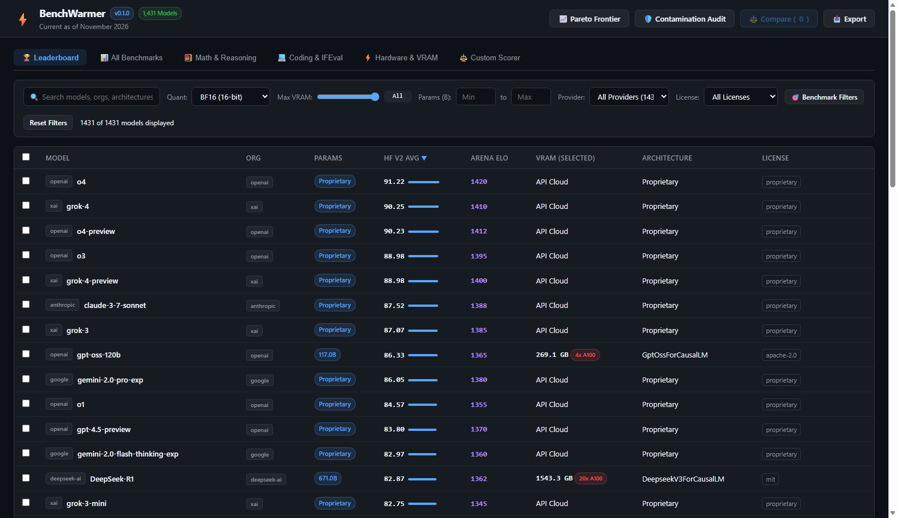

# BenchWarmer

[](https://github.com/AuraCoreDynamics/BenchWarmer/actions/workflows/ci.yml)
[](LICENSE)
[](https://www.python.org/)
[](pyproject.toml)

> **Offline Zero-Dependency LLM Benchmark Oracle & Pareto Routing Engine**

BenchWarmer is a high-speed, strictly offline, zero-runtime-dependency benchmark oracle for Large Language Models. Built on an embedded, read-only SQLite database with FTS5 full-text indexing, it delivers microsecond candidate scoring, side-by-side metric deltas, hardware-constrained Pareto frontier calculations, and Goodhart overfit/contamination audits.

---

## Architectural Highlights

- **Zero Runtime Dependencies**: Pure Python 3.9–3.13 standard library (`dependencies = []`). Runs in air-gapped, isolated, or embedded production environments.
- **Embedded Read-Only SQLite & FTS5**: Packaged with a pre-indexed `benchmarks.db` featuring 4-stage resolution cascade: exact match → case-insensitive → org-stripped → FTS5 BM25 rank.
- **Micro-Precision Invariance**: Normalized benchmark metrics stored as full 64-bit IEEE 754 floats (`REAL`). Never prematurely rounds internal math.
- **Single-File `.pyz` Executable**: Portable zipapp bundle compiled via `python scripts/make_zipapp.py`.
- **Tri-Interface Support**: Queryable as an in-process Python library (for model routers like `aurarouter`), a command-line interface, a rich dark-themed Web GUI with SVG radar and Pareto charts, or a Stdio JSON-RPC 2.0 Model Context Protocol (MCP) server.

---

## Interactive Web User Interface

BenchWarmer features a responsive, dark-themed Web UI for deep-dive benchmark exploration, multi-model comparison, hardware Pareto routing, and contamination auditing:

[](docs/USER_INTERFACE_EXAMPLES.md)

*See the complete [User Interface Visual Guide & Examples](docs/USER_INTERFACE_EXAMPLES.md) for full walkthroughs of radar scorecards, multi-model comparison charts, Pareto frontiers, and custom weighted scoring.*

---

## Installation & Quickstart

### In-Process Python Library

```bash
pip install benchwarmer
```

```python
from benchwarmer import BenchWarmer

bw = BenchWarmer()

# Compare two models with exact unrounded deltas
comparison = bw.compare("Qwen/Qwen2.5-72B-Instruct", "meta-llama/Llama-3.3-70B-Instruct")
print(f"Composite Delta: {comparison.composite_delta:+.2f}")
for bench, delta in comparison.deltas.items():
    print(f"  {bench}: {delta.score_a:.2f} vs {delta.score_b:.2f} (winner: {delta.winner})")

# Score candidates for routing (e.g. aurarouter dynamic dispatch)
candidates = ["meta-llama/Llama-3.1-8B-Instruct", "Qwen/Qwen2.5-7B-Instruct", "microsoft/Phi-4"]
weights = {"ifeval": 0.4, "math_hard": 0.4, "mmlu_pro": 0.2}
ranked = bw.score_candidates(candidates=candidates, weights=weights)
for item in ranked:
    print(f"{item.matched_model_id}: {item.composite_score:.2f}")

# Calculate Pareto optimal frontier within a 24GB VRAM constraint
pareto = bw.pareto_frontier(metric="hf_v2_avg", max_vram_gb=24.0, quant="q4_k_m")
for point in pareto:
    print(f"{point.model_id} ({point.estimated_vram_gb:.1f} GB): score {point.score:.2f}")
```

---

## AuraRouter Native Integration

BenchWarmer serves as the offline, zero-network benchmark oracle for [AuraRouter](https://github.com/AuraCoreDynamics/aurarouter):

- **Data-Driven Cold-Start Priors**: Translates empirical benchmark metrics into Beta prior distributions across complexity bands (Band 0: IFEval/Arena Elo; Band 1: balanced composite; Band 2: math_hard/gpqa) for contextual Thompson sampling.
- **Stage 1 Hardware VRAM Gating**: Gating local candidate models against available GPU memory using check_hardware_fit(model_id, max_vram_gb, quant) to prune oversized models before dispatch.
- **Stage 2 Contamination Audit Defense**: Dampens synthetic benchmark overfitting and reasoning cliff traps by penalizing models flagged with HIGH_CONTAMINATION_RISK by 0.60x via ContaminationAuditFactor.
- **Automatic Catalog Enrichment**: Automatically enriches discovered model configurations with parameter counts (params_b), benchmark metrics, and quantization VRAM envelopes.

---

## Command Line Interface (CLI)

```bash
# Search models with parameter filtering
benchwarmer search "llama" --min-params 7.0 --max-params 75.0 --format table

# Side-by-side model comparison
benchwarmer compare "Qwen/Qwen2.5-72B-Instruct" "meta-llama/Llama-3.3-70B-Instruct" --format markdown

# Rank models under hardware VRAM constraint
benchwarmer rank --benchmark math_hard --vram 48.0 --quant q4_k_m --limit 5

# Pipe candidate model IDs from stdin for weighted scoring
cat candidates.json | benchwarmer score --candidates - --weights ifeval=0.5,math_hard=0.5 --format json

# Compute Pareto-optimal efficiency frontier
benchwarmer pareto --metric hf_v2_avg --quant bf16 --format table

# Audit a model for benchmark contamination or Goodhart overfit smells
benchwarmer audit "overfit-ai/Goodhart-Overfit-7B" --format json
```

---

## Single-File `.pyz` Distribution

For air-gapped environments or sneakernet deployment, BenchWarmer compiles into a single executable archive:

```bash
python scripts/make_zipapp.py
# Produces dist/benchwarmer.pyz (~38 KB)

python dist/benchwarmer.pyz compare "Qwen/Qwen2.5-72B-Instruct" "meta-llama/Llama-3.3-70B-Instruct" --format json
```

---

## Stdio MCP Server (JSON-RPC 2.0)

BenchWarmer includes a native Model Context Protocol server over standard I/O:

```bash
benchwarmer mcp
```

Add to Claude Desktop (`claude_desktop_config.json`) or Cursor:

```json
{
  "mcpServers": {
    "benchwarmer": {
      "command": "python",
      "args": ["-m", "benchwarmer", "mcp"]
    }
  }
}
```

See [docs/MCP_GUIDE.md](docs/MCP_GUIDE.md) for full configuration details.

---

## Graphical User Interface (GUI)

BenchWarmer provides both a modern browser-based Web GUI and a fallback Tkinter desktop client:

```bash
# Launch the interactive Web GUI (auto-opens browser)
benchwarmer gui

# Or launch directly with custom host/port:
python -m benchwarmer.web.server --port 8765
```

### Visual Features:
- **Leaderboard & Filters**: Explore 1,431 models with sub-second FTS search, provider/license click-to-filter, and active chip toggling.
- **Model Scorecard Modal**: Double-click any row to view 6-axis SVG radar polygons and 10-quantization VRAM matrices.
- **Multi-Model Comparator**: Side-by-side radar overlays, horizontal benchmark bar charts with Best-in-Class crown awards, and one-click Markdown clipboard exports.
- **Pareto Frontier Analysis**: 2D scatter plots of capability vs. VRAM with non-dominated frontier curves and hardware tier classifications.
- **Contamination & Overfit Audits**: Z-score spread, anomaly scores, and Goodhart overfit detection.
- **Custom Weighted Scorer**: Real-time capability weight sliders with presets for Math, Coding, Chat, and Balanced tasks.

For a full screenshot gallery and walkthrough, see [User Interface Visual Guide & Examples](docs/USER_INTERFACE_EXAMPLES.md).

---

## Automated Selenium UI Testing & Screenshot Capture

BenchWarmer includes an automated Selenium test harness that validates DOM elements, SVG charts, modals, and tag filters, while programmatically capturing high-resolution screenshots for documentation:

```bash
# Execute headless Selenium tests and refresh documentation screenshots:
python scripts/capture_screenshots.py

# Or via standard unittest:
python -m unittest tests/unit/test_selenium_ui.py
```

---

## Governance & Verification

BenchWarmer enforces the BLACK Framework v2.2 specification:
- `python scripts/black_preflight_audit.py`: AST-level precision check, zero-runtime-dependency verification, and remediation mode test-fixture immutability gate.
- `python scripts/black_redteam_harness.py scoring.json`: Red-team validation against test density and numerical precision invariance.

---

## License

MIT License. See [LICENSE](LICENSE) for details.
