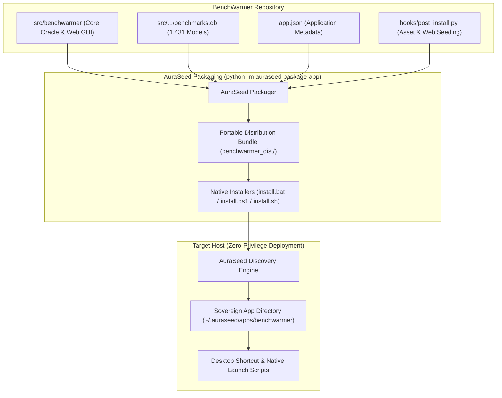

# Quick Deployment with AuraSeed

[AuraSeed](https://github.com/AuraCoreDynamics/auraseed) is a zero-privilege Python runtime discovery and environment seeding engine designed to package, provision, and deploy self-contained sovereign applications without requiring administrative privileges, internet access at runtime, or pre-configured global Python in system `%PATH%`.

BenchWarmer is natively integrated with AuraSeed for single-command packaging and zero-friction deployment across air-gapped workstations, developer laptops, and production servers.

---

## Table of Contents
1. [Why AuraSeed for BenchWarmer?](#why-auraseed-for-benchwarmer)
2. [AuraSeed Deployment Architecture](#auraseed-deployment-architecture)
3. [Quick Start: One-Line Deployment](#quick-start-one-line-deployment)
4. [Packaging BenchWarmer for Distribution](#packaging-benchwarmer-for-distribution)
5. [Installation & Deployment Modes](#installation--deployment-modes)
6. [Launching Deployed Applications](#launching-deployed-applications)
7. [Enterprise & Air-Gapped Environments](#enterprise--air-gapped-environments)
8. [Troubleshooting & Lifecycle Hooks](#troubleshooting--lifecycle-hooks)

---

## Why AuraSeed for BenchWarmer?

Standard Python application deployment often suffers from brittle global environments, path conflicts, missing binary assets (like Tcl/Tk for desktop interfaces), and permission barriers. [AuraSeed](https://github.com/AuraCoreDynamics/auraseed) eliminates these issues:

| Deployment Concern | Standard Python (`pip install`) | AuraSeed Sovereign Deployment |
|---|---|---|
| **Administrative Access** | Often requires admin/sudo for system paths | **Zero-privilege**: Installs into user home (`~/.auraseed/apps/`) |
| **Python Discovery** | Fails if `python` is not in system `%PATH%` | **Native OS Bootstrappers**: Scans Windows Registry, PATH, and common roots |
| **Environment Isolation** | May mutate global packages or break dependencies | **Sovereign virtual environment**: Completely isolated per application |
| **Asset Self-Sufficiency** | Desktop GUI crashes if host Python lacks Tcl/Tk | **Automated lifecycle hook**: Seeds full Tcl/Tk and web servers out of the box |
| **Launchers & Shortcuts** | Manual script creation and PATH management | **Automated generation**: Desktop shortcut, `.bat`, and `.ps1` launchers |
| **Air-Gapped Operation** | Requires active PyPI internet connectivity | **Self-contained payload**: Bundles all code and embedded SQLite database |

---

## AuraSeed Deployment Architecture

The AuraSeed lifecycle packages BenchWarmer into a portable installer bundle containing self-extracting scripts and standalone lifecycle hooks:



---

## Quick Start: One-Line Deployment

If you have a compiled distribution bundle (e.g. `C:\dev\benchwarmer_dist`), deploy BenchWarmer instantly with a single command:

### Windows (PowerShell)
```powershell
# Silent installation with automated launcher creation
python -m auraseed install-app C:\dev\benchwarmer_dist -s --force
```

### Windows (Command Prompt / Standalone Installer)
```cmd
:: Using the bundled native batch installer directly (no pre-existing AuraSeed CLI required)
C:\dev\benchwarmer_dist\install.bat -s
```

### Linux / macOS (Bash)
```bash
./benchwarmer_dist/install.sh -s
```

After installation completes, BenchWarmer is immediately ready to run from your desktop shortcut or via:
```cmd
%USERPROFILE%\.auraseed\apps\benchwarmer\run-benchwarmer.bat
```

---

## Packaging BenchWarmer for Distribution

To generate a new self-contained distribution bundle from the source repository, use the [AuraSeed](https://github.com/AuraCoreDynamics/auraseed) packager:

### 1. Application Manifest (`app.json`)
BenchWarmer defines its packaging contract in [`app.json`](file:///C:/dev/benchwarmer/app.json):
```json
{
  "name": "benchwarmer",
  "display_name": "BenchWarmer - Offline LLM Benchmark Oracle",
  "version": "0.1.0",
  "description": "Offline Zero-Dependency LLM Benchmark Oracle & Pareto Routing GUI",
  "entrypoint_command": "benchwarmer gui",
  "default_dest": "~/.auraseed/apps/benchwarmer",
  "source_path": ".",
  "hooks": {
    "post_install": "hooks/post_install.py"
  },
  "create_desktop_shortcut": true,
  "create_launchers": true
}
```

### 2. Package the Application
Execute the packaging command pointing to the BenchWarmer repository root:
```powershell
python -m auraseed package-app C:\dev\benchwarmer --out C:\dev\benchwarmer_dist
```

This generates `C:\dev\benchwarmer_dist` containing:
- `payload/`: The complete BenchWarmer package, embedded benchmarks SQLite database (1,431 models), web assets, and CLI entry points.
- `hooks/post_install.py`: Standalone execution hook ensuring runtime assets and dependencies are provisioned.
- `install.bat`, `install.ps1`, `install.sh`: Native OS installer scripts.
- `auraseed/`: Embedded bootstrap runtime for host systems where AuraSeed is not yet installed.

---

## Installation & Deployment Modes

[AuraSeed](https://github.com/AuraCoreDynamics/auraseed) supports multiple installation modes depending on user workflow and automation requirements:

### Mode 1: Silent Automated Install (`-s`)
Ideal for CI/CD pipelines, automated staging, and scripted workstation setup:
```powershell
python -m auraseed install-app C:\dev\benchwarmer_dist -s --force
```

### Mode 2: Interactive Desktop Installer GUI
Running the installer without `-s` launches the native AuraSeed installation wizard:
```cmd
C:\dev\benchwarmer_dist\install.bat
```
The wizard lets the user select installation directories, choose port assignments, and toggle desktop shortcut creation.

### Mode 3: Custom Port & Destination
Deploy to a custom directory or bind to a specific service port:
```powershell
python -m auraseed install-app C:\dev\benchwarmer_dist --dest "D:\apps\benchwarmer" --port 9000
```

---

## Launching Deployed Applications

Once deployed by AuraSeed, BenchWarmer offers multiple native launch vectors:

1. **Desktop Shortcut**: Double-click `BenchWarmer - Offline LLM Benchmark Oracle` on your Windows Desktop.
2. **Native Batch Launcher**:
   ```cmd
   %USERPROFILE%\.auraseed\apps\benchwarmer\run-benchwarmer.bat
   ```
3. **PowerShell Launcher**:
   ```powershell
   & "$env:USERPROFILE\.auraseed\apps\benchwarmer\run-benchwarmer.ps1"
   ```
4. **Convenience Root Launcher**:
   ```cmd
   C:\dev\run_benchwarmer_gui.bat
   ```
   *This launcher automatically checks if the AuraSeed sovereign app is present and launches it, auto-installs it from `benchwarmer_dist` if missing, or falls back to in-place execution.*

---

## Enterprise & Air-Gapped Environments

In restricted or air-gapped enterprise environments:

- **No PyPI Connection Required**: The distribution bundle contains all necessary code and data assets.
- **No Global Python Footprint**: Does not modify system-wide Python environments, Anaconda bases, or ArcGIS/QGIS embedded Python installations.
- **Read-Only SQLite Invariance**: The 1,431 model benchmark database (`benchmarks.db`) is embedded and opened read-only, preventing runtime state corruption.
- **Sovereign Isolation**: Applications deployed via AuraSeed maintain their own sovereign virtual environment (`~/.auraseed/apps/benchwarmer/`), isolated from user packages.

---

## Troubleshooting & Lifecycle Hooks

### Post-Install Lifecycle Hook (`hooks/post_install.py`)
During installation, AuraSeed automatically executes [`hooks/post_install.py`](file:///C:/dev/benchwarmer/hooks/post_install.py) within the target virtual environment:
1. **Desktop Tcl/Tk Runtime Assets**: Automatically copies and links Tcl/Tk 9.0/8.6 runtime libraries into `lib/` so that the desktop GUI runs out-of-the-box on stripped host Python distributions.
2. **Web GUI Infrastructure**: Verifies that `fastapi` and `uvicorn` are provisioned in the sovereign environment to support the modern dark-themed Web GUI.

### Re-installing or Updating
When upgrading an existing BenchWarmer installation, ensure any running instances are closed before updating:
```powershell
# Stop existing instances if running
Stop-Process -Name "python*" -ErrorAction SilentlyContinue

# Force reinstall
python -m auraseed install-app C:\dev\benchwarmer_dist -s --force
```

### Links & Further Reading
- **AuraSeed GitHub Repository**: [https://github.com/AuraCoreDynamics/auraseed](https://github.com/AuraCoreDynamics/auraseed)
- **BenchWarmer Web UI Visual Guide**: [User Interface Visual Guide & Examples](USER_INTERFACE_EXAMPLES.md)
- **Model Context Protocol (MCP) Guide**: [BenchWarmer MCP Server Guide](MCP_GUIDE.md)
- **AuraRouter Dynamic Dispatch Integration**: [AuraRouter Repository](https://github.com/AuraCoreDynamics/aurarouter)
