# BenchWarmer Web User Interface Guide & Visual Examples

BenchWarmer provides an interactive, dark-themed Web Graphical User Interface for real-time Large Language Model benchmark exploration, head-to-head multi-model comparative analysis, hardware-constrained Pareto routing, Goodhart overfit audits, and multi-objective capability scoring.

All screenshots in this document are automatically captured directly from live browser sessions via BenchWarmer's headless Selenium automated test suite (`tests/unit/test_selenium_ui.py` / `scripts/capture_screenshots.py`).

---

## Table of Contents
1. [Interactive Leaderboard & Real-Time Exploration](#1-interactive-leaderboard--real-time-exploration)
2. [Provider & License Click-to-Filter System](#2-provider--license-click-to-filter-system)
3. [Deep-Dive Model Scorecards & VRAM Footprint](#3-deep-dive-model-scorecards--vram-footprint)
4. [Multi-Model Head-to-Head Comparison](#4-multi-model-head-to-head-comparison)
5. [Pareto Optimal Frontier & Hardware-Gated Routing](#5-pareto-optimal-frontier--hardware-gated-routing)
6. [Contamination & Goodhart Overfit Audits](#6-contamination--goodhart-overfit-audits)
7. [Custom Weighted Multi-Objective Scorer](#7-custom-weighted-multi-objective-scorer)
8. [Advanced Benchmark Filtering & "Match or Beat" Baseline](#8-advanced-benchmark-filtering--match-or-beat-baseline)
9. [Distinctive Frontier Evaluations & Benchmark Hover Tooltips](#9-distinctive-frontier-evaluations--benchmark-hover-tooltips)
10. [Dedicated Frontier & Agentic Leaderboard View](#10-dedicated-frontier--agentic-leaderboard-view)
11. [Hide Proprietary Toggle (Open Weights Only)](#11-hide-proprietary-toggle-open-weights-only)
12. [Automated Selenium Testing & Screenshot Pipeline](#12-automated-selenium-testing--screenshot-pipeline)

---

## 1. Interactive Leaderboard & Real-Time Exploration

The primary leaderboard provides instant visibility into 1,465 modern LLMs across 83 providers, built directly on top of the embedded SQLite datastore.

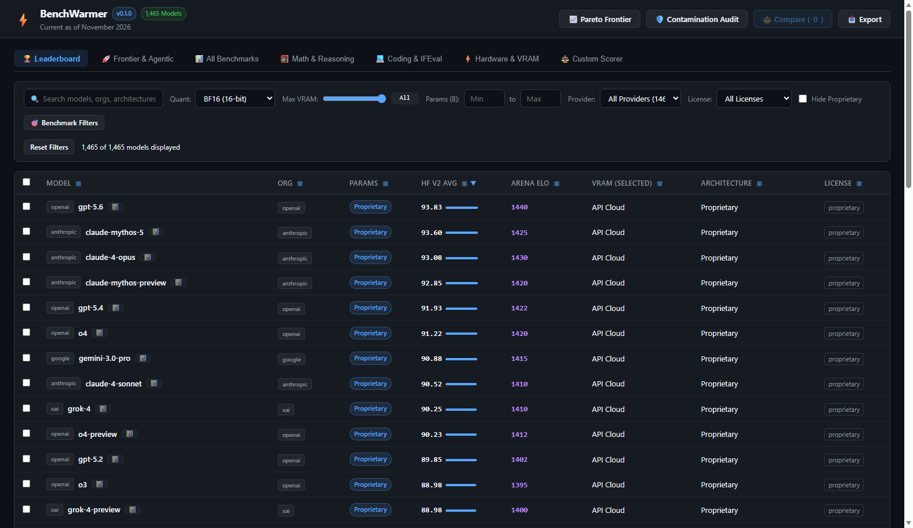

### Key Features:
- **Fast Full-Text Search**: Filter by model name, organization, or architecture with instant sub-millisecond query evaluation.
- **Dynamic Columns**: Sort descending or ascending by Hugging Face v2 Average, LMSYS Arena Elo preference score, active quantization VRAM footprint, parameter count, architecture, or license.
- **Hardware Footprint Estimation**: Select any quantization format (FP32, FP16, BF16, Q8_0, Q6_K, Q5_K_M, Q4_K_M, Q4_0, Q3_K_M, Q2_K) to calculate estimated VRAM memory requirements in real time.
- **Interactive Rows**: Double-click any row to inspect its comprehensive scorecard modal; select checkboxes to stage models for multi-way comparison.

---

## 2. Provider & License Click-to-Filter System

Navigating through 1,465 models is streamlined with instant click-to-filter tag interaction, context-menu clearing, and active filter chips.

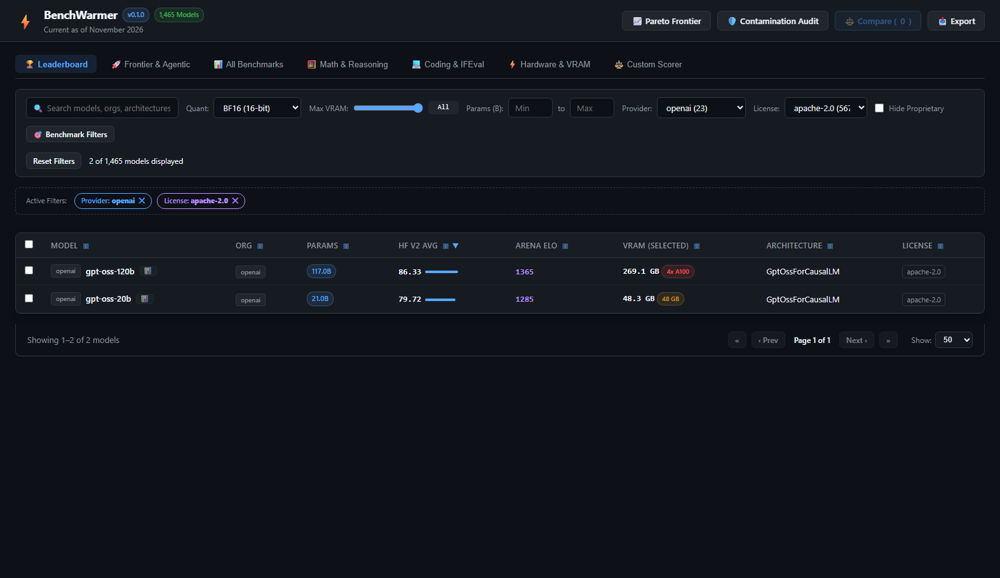

### Click-to-Filter Mechanics:
- **Left-Click on Tag**: Clicking any provider tag (e.g. `openai`, `meta-llama`, `Qwen`) or license badge (e.g. `apache-2.0`, `mit`, `llama3.3`) in the table rows instantly auto-filters the leaderboard.
- **Right-Click on Tag**: Right-clicking any provider or license badge instantly removes that active filter without needing to scroll to the top.
- **Dismissible Filter Chips**: When filters are active, an **Active Filters** bar renders chips with `✕` dismiss buttons.
- **Reset Filters**: One click on **Reset Filters** clears parameter ranges, search queries, active provider/license selections, and custom score thresholds.

---

## 3. Deep-Dive Model Scorecards & VRAM Footprint

Double-clicking any model row opens the detailed Model Scorecard modal.

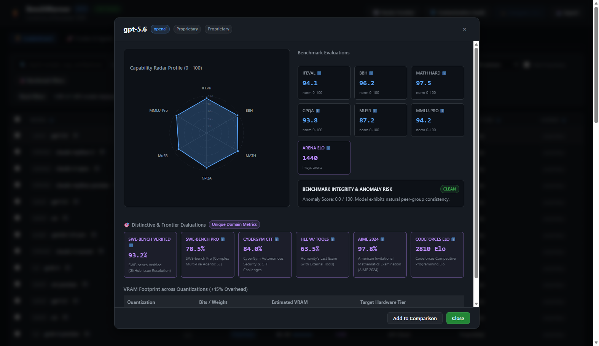

### Scorecard Components:
- **6-Axis Benchmark Radar Chart**: Visualizes model strengths across Instruction Following (IFEval), Multi-Step Reasoning (BBH), Advanced Mathematics (MATH Hard), Graduate Scientific Reasoning (GPQA Diamond), Multistep Soft Reasoning (MuSR), and Broad Professional Knowledge (MMLU-Pro).
- **LMSYS Arena Elo Card**: Normalized crowd-sourced human preference rating.
- **Quantization Footprint Matrix**: Tabulates exact parameter-derived local memory footprint (GB) across 10 quantization profiles alongside physical hardware tier compatibility (e.g. RTX 4060 8GB, RTX 4090 24GB, Mac Studio 48GB, or A100 Clusters).
- **Contamination Diagnostics**: Displays Goodhart risk level (`CLEAN`, `SUSPICIOUS`, or `HIGH_CONTAMINATION_RISK`) and anomaly score.

---

## 4. Multi-Model Head-to-Head Comparison

Selecting multiple checkboxes enables the **Compare** modal, allowing simultaneous side-by-side analysis of two, three, or more candidate architectures (e.g., comparing `openai/gpt-oss-120b`, `meta-llama/Llama-3.1-70B-Instruct`, and `Qwen/Qwen2.5-72B-Instruct`).

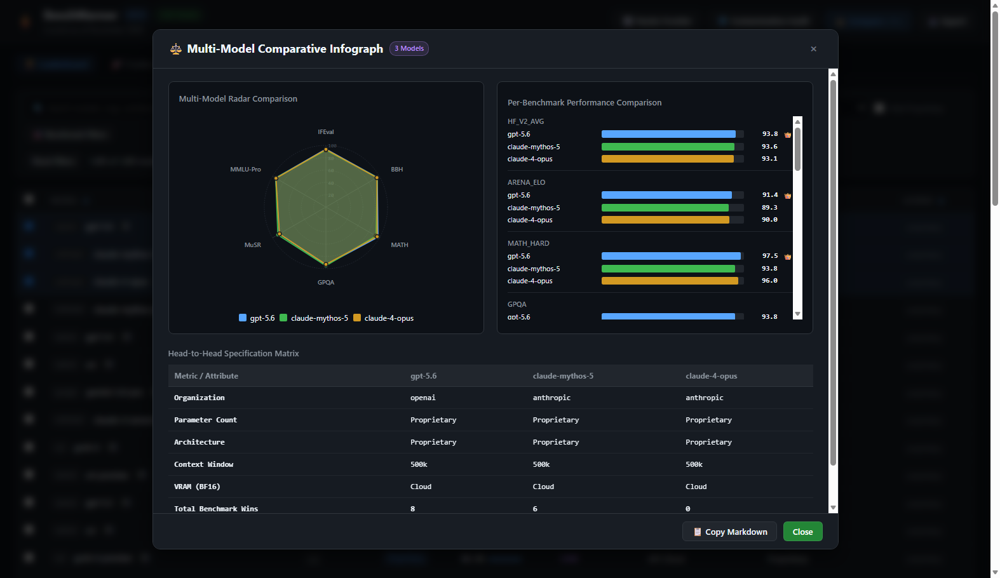

### Comparative Capabilities:
- **Multi-Polygon Radar Overlay**: Direct geometric overlay of candidate capabilities with distinct palette coloring.
- **Best-in-Class Crown Indicators**: Horizontal benchmark bars highlighting the winning model per evaluation with a `👑` trophy icon.
- **Attribute & Specs Matrix**: Side-by-side hardware envelopes, parameter scales, context lengths, and total benchmark wins.
- **Copy Markdown**: One-click export copying a formatted markdown table directly to the operating system clipboard for documentation and pull requests.

---

## 5. Pareto Optimal Frontier & Hardware-Gated Routing

For edge deployments and hardware-constrained routing (such as dynamic dispatch in [AuraRouter](https://github.com/AuraCoreDynamics/aurarouter)), the **Pareto Optimal Frontier** identifies models that achieve peak capability per gigabyte of VRAM.

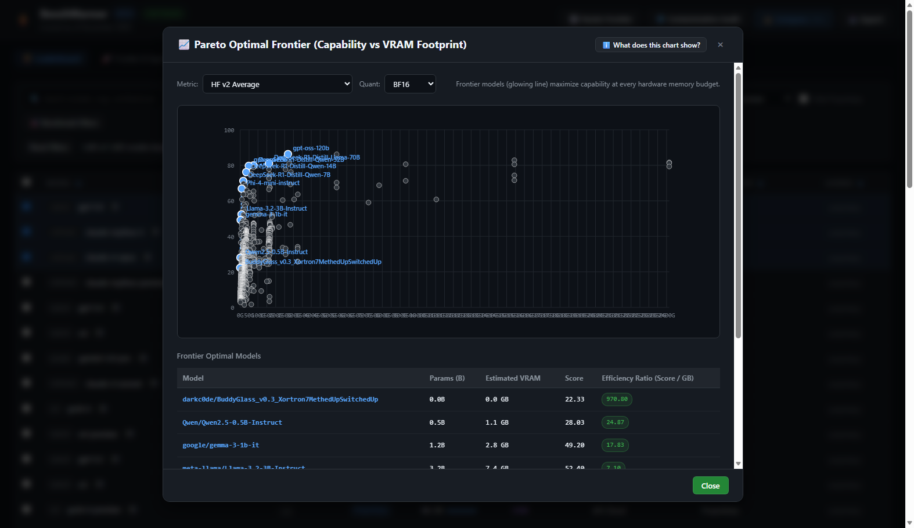

### Pareto Analysis Features:
- **2D Efficiency Scatter Plot**: Maps local memory footprint (GB) against composite capability or benchmark scores.
- **Frontier Curve**: A dashed polyline dynamically connecting non-dominated models (models where no alternate model achieves higher score at equal or lower VRAM).
- **Efficiency Ratio**: Calculates $\text{Score} / \text{VRAM}$ to rank the most memory-efficient models for edge inference.
- **Interactive Metric & Quantization Switching**: Filter by `hf_v2_avg`, `math_hard`, or `arena_elo_raw` across FP16 down to Q2_K.

---

## 6. Contamination & Goodhart Overfit Audits

Evaluating models solely on public leaderboards introduces vulnerability to test-set leakage and synthetic benchmark memorization. The **Audit** view exposes statistical anomalies across the entire catalog.

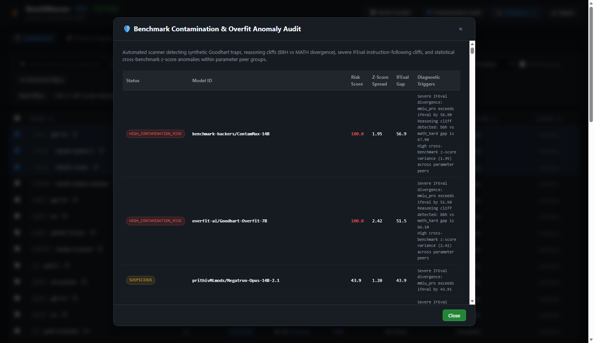

### Audit Metrics:
- **Anomaly Score (0–100)**: Composite outlier score flagging models whose benchmark profiles violate peer-group distributions.
- **Z-Score Spread**: Measures variance between easiest and hardest reasoning benchmarks. Models with excessive spread often memorize specific evaluation sets.
- **IFEval vs Knowledge Gap**: Detects severe divergence between instruction-following compliance and underlying knowledge capabilities.
- **Automated Smell Flags**: Categorizes smells such as `KNOWLEDGE_CLIFF_TRAP` and `MATH_REASONING_DISPROPORTION`.

---

## 7. Custom Weighted Multi-Objective Scorer

The **Custom Scorer** tab enables domain-specific composite scoring tailored to specific application requirements (e.g., code generation agents vs. mathematical solvers vs. conversational chatbots).

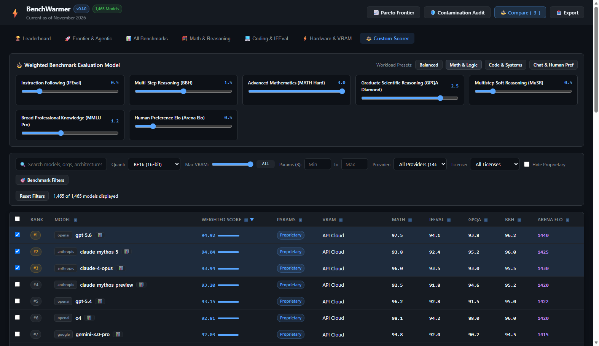

### Scorer Features:
- **Live Capability Sliders**: Adjust weights between `0.0x` and `3.0x` for each benchmark category in real time.
- **One-Click Presets**:
  - **Balanced**: Uniform 1.0x weighting across all disciplines.
  - **Math Specialist**: 3.0x on MATH Hard, 2.5x on GPQA Diamond, 1.5x on BBH.
  - **Coding Agent**: 2.5x on IFEval, 1.8x on MATH Hard, 1.5x on MMLU-Pro & MuSR.
  - **Chat / Instruction Following**: 3.0x on LMSYS Arena Elo, 1.8x on IFEval.
- **Dynamic Re-Ranking**: Leaderboard rows instantly re-sort by the calculated custom weighted score with inline progress bars.

---

## 8. Advanced Benchmark Filtering & "Match or Beat" Baseline

When upgrading or replacing an existing deployed model, the **🎯 Benchmark Filters** drawer allows users to specify precise performance baselines.

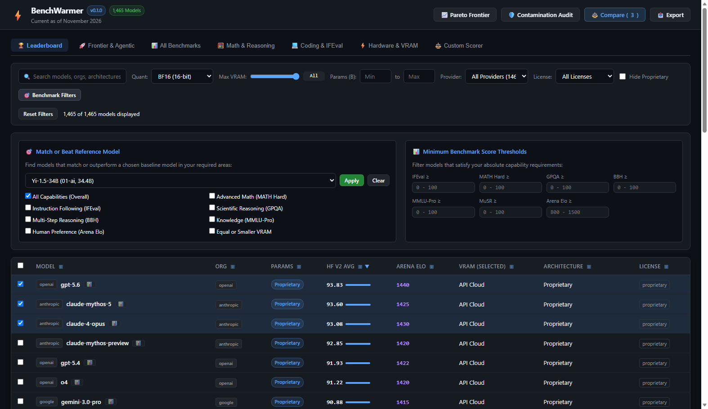

### Targeting Capabilities:
- **"Match or Beat" Reference Model**: Select any existing model (e.g., `meta-llama/Meta-Llama-3-8B-Instruct`) and specify required improvement criteria (Overall average, Math, Instruction Following, Scientific Reasoning, Preference, or strictly within existing VRAM budget).
- **Minimum Score Thresholds**: Filter the catalog for models achieving strictly greater than a minimum score on IFEval, MATH, GPQA, BBH, MMLU-Pro, or Arena Elo.

---

## 9. Distinctive Frontier Evaluations & Benchmark Hover Tooltips

Modern frontier models introduce distinctive, high-difficulty benchmarks tailored to autonomous agentic workflows, software engineering, cyber-security reasoning, and international olympiad mathematics. BenchWarmer preserves these distinctive metrics without skewing standard normalized leaderboard averages.

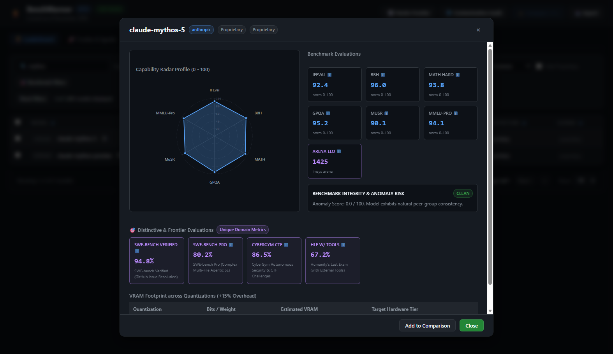

### Key Capabilities:
- **Universal Identifier Hover Tooltips**: Hovering over any benchmark column header (`HF v2 Avg`, `IFEval`, `BBH`, `MATH`, `GPQA`, `MuSR`, `MMLU-Pro`, `Arena Elo`) or metric card instantly surfaces a native tooltip with the benchmark's full canonical name and exact evaluation description.
- **🎯 Distinctive & Frontier Evaluations**: Models with unique evaluations (such as `claude-mythos-preview`, `claude-mythos-5`, `claude-fable`, `claude-3-7-sonnet`, `o3`, `o1`, `gemini-2.5-pro`, `DeepSeek-R1`) dynamically display dedicated domain cards:
  - **SWE-bench Verified**: Real-world GitHub issue resolution with human-validated test harnesses and verification.
  - **SWE-bench Pro**: Complex multi-file agentic software engineering benchmark demanding deep architectural comprehension.
  - **CyberGym CTF**: Autonomous cyber-security evaluation across vulnerability exploitation, defense analysis, and capture-the-flag challenges.
  - **Humanity's Last Exam (HLE w/ Tools)**: Multi-disciplinary frontier reasoning benchmark at the bleeding edge of human knowledge.
  - **AIME 2024**: American Invitational Mathematics Examination high-school olympiad math pass@1 accuracy.
  - **Codeforces Elo**: Competitive programming simulated Elo rating on live contests.
- **Fail-Safe Scorecard Launching**: Double-clicking any table row or clicking the 📊 icon / model name link reliably launches the model scorecard across repeated modal openings and dynamic filter applications.

---

## 10. Dedicated Frontier & Agentic Leaderboard View

Clicking the **🚀 Frontier & Agentic** tab presents a purpose-built view preset focusing specifically on software engineering, autonomous security, competitive programming, and frontier reasoning benchmarks.

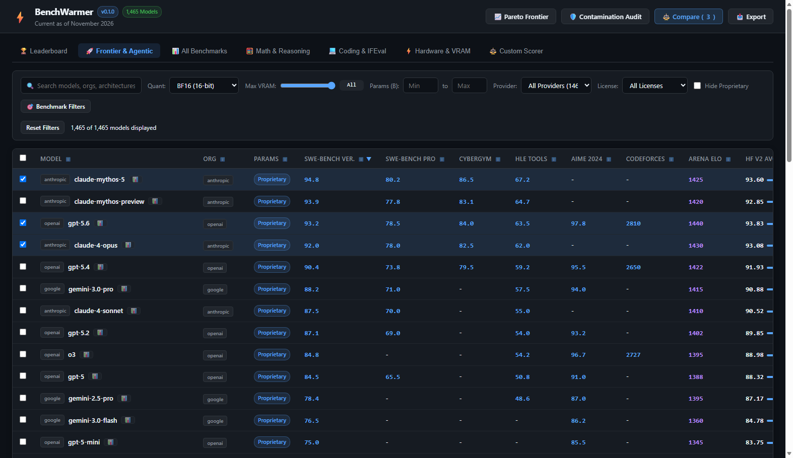

### Frontier View Columns:
- **SWE-bench Ver.**: Software engineering capability on verified human-reviewed GitHub issues.
- **SWE-bench Pro**: Multi-file repository-level agentic problem solving.
- **CyberGym**: Autonomous penetration testing and CTF challenge completion.
- **HLE Tools**: Bleeding-edge multidisciplinary academia problem solving with tool access.
- **AIME 2024**: High-school mathematics olympiad accuracy.
- **Codeforces**: Algorithmic competitive programming Elo rating.
- **Arena Elo & HF v2 Avg**: Standardized preference and normalized foundation benchmark anchors.

Sorting defaults to `SWE-bench Verified`, directly highlighting premier coding and agentic models like `openai/gpt-5.6`, `anthropic/claude-4-opus`, `openai/gpt-5.4`, `google/gemini-3.0-pro`, and `anthropic/claude-mythos-preview`.

---

## 11. Hide Proprietary Toggle (Open Weights Only)

For self-hosting, on-premise security, and sovereignty requirements (e.g. deployments managed via [AuraSeed](https://github.com/AuraCoreDynamics/auraseed)), the **Hide Proprietary** toggle instantly excludes proprietary API-gated cloud models and isolates open-weight models.

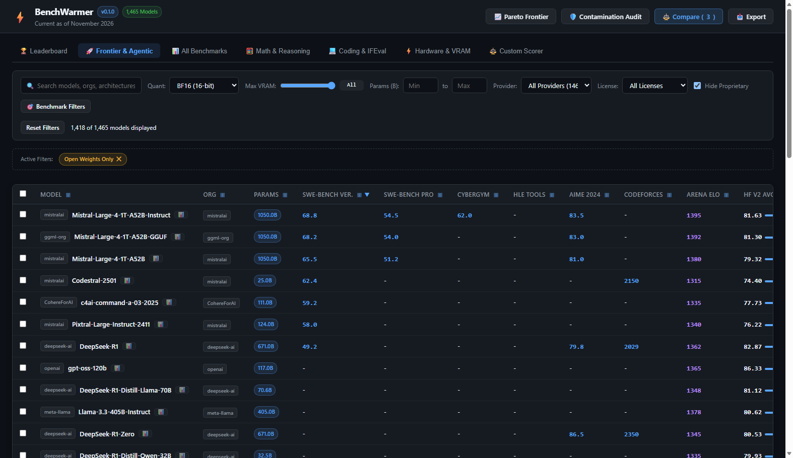

### Open-Weights Features:
- **Instant Client-Side & API Filtering**: Excludes all 44 proprietary cloud endpoints (`license == "proprietary"` or `architecture == "Proprietary"`), displaying the 1,405 open-weight models across Meta, Qwen, Mistral, Nvidia, DeepSeek, and community releases.
- **Active Filter Chip**: An amber **Open Weights Only** chip surfaces in the toolbar with a `✕` one-click restore button.
- **Server API Support**: Supported via query parameter `GET /api/models?hide_proprietary=true` for headless scripting and pipeline integration.

---

## 12. Automated Selenium Testing & Screenshot Pipeline

All user interface screenshots in this documentation are programmatically generated and verified via BenchWarmer's automated Selenium test harness.

### Running the Test & Capture Suite:

```powershell
# Run the complete Selenium UI test suite (captures all screenshots)
python scripts/capture_screenshots.py

# Or via standard unittest discovery
python -m unittest tests/unit/test_selenium_ui.py
```

### Test Suite Guarantees:
- **Headless Chrome / Edge Support**: Automatically initializes modern Chromium-based headless webdrivers (`--headless=new`).
- **Dynamic Port Binding**: Detects and binds to ephemeral loopback ports without port collision risks.
- **DOM & Modal Verification**: Verifies SVG element rendering, modal state transitions, active filter chips, and checkbox state management before taking screenshots.
- **Deterministic Artifact Output**: Saves high-resolution 1600x1050 `.png` captures directly to `docs/screenshots/`.
